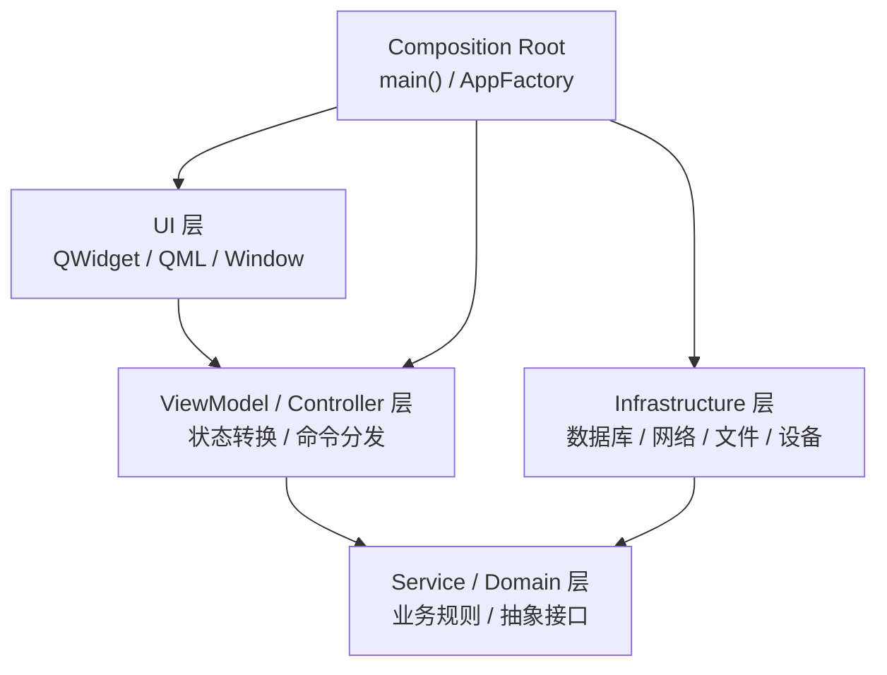

# Qt 项目架构规范

## 1. 文档范围

本文适用于本仓库中的 Qt 5.15.2 和 Qt 6 项目。本文定义推荐的分层结构、模块边界、依赖方向和测试要求。

当前仓库主要保存工程规范，尚未包含具体 Qt 业务实现。因此本文描述目标架构和新增代码必须遵守的约束，不代表当前仓库已经完成这些模块。

本文参考 [C++/Qt 项目](https://cloud.tencent.com/developer/article/2773106) 的分层、依赖注入、对象所有权和测试建议。

## 2. 架构总览

Qt 项目划分为四层：

| 层 | 主要内容 | 允许承担的职责 |
| --- | --- | --- |
| UI | `QWidget`、窗口、控件、QML 文件 | 展示状态、收集输入、转发用户操作 |
| ViewModel / Controller | 页面状态、命令分发、数据转换 | 连接 UI 与业务，管理界面状态 |
| Service / Domain | 业务规则、领域对象、服务接口 | 执行业务决策和纯逻辑计算 |
| Infrastructure | 数据库、网络、文件、设备和平台实现 | 访问外部资源并实现下层接口 |

业务逻辑禁止集中在 `MainWindow`、页面类或控件槽函数中。窗口类只负责界面编排，业务判断必须放在 Service / Domain 层。



图中的编译依赖遵循依赖倒置。Domain 定义抽象接口，Infrastructure 提供实现，组合根负责组装具体对象。Qt 官方 Model/View 文档也将数据模型与界面呈现分离，并通过标准模型接口连接不同数据源和视图。

## 3. 各层边界

### 3.1 UI 层

UI 层包括窗口、控件、QML 页面、资源和界面事件处理。

- 只负责展示数据、收集输入和转发命令。
- 禁止直接执行数据库查询、网络请求、文件扫描和业务规则判断。
- 禁止直接创建 Infrastructure 的具体实现。
- 不保存跨页面的业务状态。
- 耗时操作必须通过 ViewModel / Controller 调度，不能阻塞 GUI 线程。
- 用户可见文本、控件状态和错误提示由 UI 层负责转换。

### 3.2 ViewModel / Controller 层

ViewModel / Controller 层是 UI 和业务层之间的适配层。

- 将 UI 输入转换为业务命令或参数对象。
- 将业务结果转换为 UI 可展示的状态。
- 管理页面状态、加载状态、错误状态和命令可用性。
- 负责连接信号、槽和异步结果。
- 只做 UI 与业务接口之间的适配、转换和状态管理，不编写业务规则。
- 业务判断必须委托给 Service / Domain，禁止在 ViewModel、Controller 或槽函数中复制业务规则。
- 可以依赖 Service / Domain 接口，禁止依赖 Infrastructure 具体类。
- 不实现数据库、网络和文件访问细节。

### 3.3 Service / Domain 层

Service / Domain 层承载可以脱离界面验证的业务逻辑。

- Domain 核心必须是纯 C++，不得包含 `QtWidgets` 或 `QtQuick` 头文件。
- Core 不得感知 `QObject`、`QWidget`、QML、绘图对象或 GUI 事件循环。
- Core 不执行数据库、网络、文件和设备 I/O。
- Core 不拥有 UI 资源。
- 所有耗时操作不得放入 Core 的同步接口。
- Core 不得直接调用 UI 代码，只能通过返回值、抽象接口或抽象回调传递结果。
- Service 可以编排 Domain 和 Infrastructure 接口，但不能把外部依赖细节写入 Domain 规则。

Domain 可以定义端口接口：

```cpp
class OrderRepository
{
public:
    virtual ~OrderRepository() = default;

    virtual ErrorCode save(const Order& order) = 0;
    virtual ErrorCode find(OrderId id, std::optional<Order>& order) const = 0;
};

class OrderService
{
public:
    explicit OrderService(OrderRepository& repository);

    ErrorCode submit(const Order& order);

private:
    OrderRepository& repository_;
};
```

接口必须遵守 [C++ API 设计规范](cpp-api-design-guidelines.md)。公共库接口需要 ABI 稳定时，另行遵守 [Qt API 设计规范](qt-api-design-guidelines.md)。

### 3.4 Infrastructure 层

Infrastructure 层实现外部依赖和平台适配。

- 实现 Domain 或 Service 定义的接口。
- 封装数据库、网络、文件、设备驱动、操作系统和第三方 SDK。
- 禁止把数据库连接、HTTP 客户端或平台句柄泄漏到 Domain。
- 外部错误必须转换为项目统一的 `ErrorCode` 或结果类型。
- 线程、重试、超时、连接池和资源释放必须在 Infrastructure 内部明确管理。

## 4. 约束与边界

以下规则是强制约束：

1. Core 是纯逻辑内核，不包含 I/O、绘图或事件循环。
2. Core 不持有 UI 资源，不感知 Qt 对象。
3. Domain 不得包含 `QtWidgets` 或 `QtQuick` 头文件。
4. 所有耗时操作不得放在 Core 的同步接口中。
5. Core 不得直接调用上层 UI 代码，只能通过抽象回调、返回值或事件接口传递结果。
6. UI 不得直接依赖 Infrastructure 具体实现。
7. 上层通过接口依赖下层，组合根负责创建和注入具体实现。
8. 模块之间禁止循环依赖。
9. 一个对象只能由一套明确的所有权机制管理。QObject 父子关系和智能指针禁止同时拥有同一个对象。
10. 跨线程 QObject 必须通过信号槽、事件或明确的线程安全接口通信。

依赖方向禁止表：

| 依赖方 | 禁止依赖 | 原因 |
| --- | --- | --- |
| UI | Infrastructure 具体实现 | UI 不得绕过 ViewModel / Controller 和 Service 直接访问外部资源。 |
| UI | Domain 内部实现 | UI 只能依赖公开的 ViewModel / Controller 或稳定的业务接口。 |
| ViewModel / Controller | Infrastructure 具体实现 | 适配层只依赖 Service / Domain 接口，具体实现由组合根注入。 |
| Domain | UI、ViewModel / Controller | 业务规则不能感知界面和交互流程。 |
| Domain | `QtWidgets`、`QtQuick`、QWidget 和 QML 类型 | Core 必须能够脱离 GUI 单独编译和测试。 |
| Domain | 数据库、网络、文件和设备实现 | 外部依赖必须通过端口接口接入。 |
| Infrastructure | UI 和 ViewModel / Controller | 基础设施层不能反向调用上层界面。 |
| 任意模块 | 同层循环依赖或跨层循环依赖 | 循环依赖会破坏单向依赖和独立测试。 |

组合根可以依赖所有运行时模块，用于创建和组装对象。测试代码可以依赖被测模块和测试替身，但生产模块不得依赖测试代码。

## 5. 依赖注入和对象组装

具体实现必须在组合根创建并注入：

```cpp
int main(int argc, char* argv[])
{
    QApplication app(argc, argv);

    SqlOrderRepository repository;
    OrderService service(repository);
    OrderViewModel viewModel(service);
    MainWindow window(viewModel);

    window.show();
    return app.exec();
}
```

- UI、ViewModel 和 Service 不得在业务方法中直接 `new` Infrastructure 实现。
- 依赖注入优先使用构造函数。
- 非拥有依赖使用引用或明确标注为借用的指针。
- QObject 父子树只管理 QObject 生命周期，非 QObject 资源使用 RAII。
- 测试时必须能够注入 fake、mock 或内存实现，不启动真实数据库和网络服务即可测试 Domain。

## 6. 推荐目录结构

目录结构只用于表达模块边界，不要求每个项目都创建全部子目录。运行时代码和测试代码分开，`app/` 是组合根，不能视为独立业务层。

```text
src/
├── app/
│   ├── main.cpp
│   └── composition/
├── ui/
│   ├── widgets/
│   ├── qml/
│   └── resources/
├── presentation/
│   ├── view_models/
│   └── controllers/
├── domain/
│   ├── entities/
│   ├── services/
│   └── ports/
├── infrastructure/
│   ├── database/
│   ├── network/
│   ├── filesystem/
│   └── platform/
└── tests/
    ├── unit/
    ├── component/
    └── integration/
```

目录与架构层的对应关系如下：

| 目录 | 对应架构 | 职责 |
| --- | --- | --- |
| `src/app/` | 组合根 | 创建具体实现、注入依赖、启动应用和事件循环。 |
| `src/ui/` | UI 层 | 窗口、控件、QML、资源和用户交互。 |
| `src/presentation/` | ViewModel / Controller 层 | 页面状态、数据转换和命令分发。 |
| `src/domain/` | Service / Domain 层 | 业务实体、业务服务和下层抽象接口。 |
| `src/infrastructure/` | Infrastructure 层 | 数据库、网络、文件、设备和平台实现。 |
| `tests/` | 测试支撑目录 | 单元、组件和集成测试，不属于运行时架构层。 |

- `entities/` 保存业务实体，`services/` 保存业务规则，`ports/` 保存 Domain 依赖的抽象接口。
- `widgets/`、`qml/` 和 `resources/` 都属于 UI 层。`resources/` 只保存界面资源，不保存业务数据访问代码。
- `composition/` 只负责组装对象，不实现业务规则。
- `infrastructure/platform/` 集中平台相关代码，禁止把平台宏散落在 Domain 和 UI 业务代码中。

小型项目不需要为了目录数量强行拆分：

- `presentation/` 中只有少量页面状态代码时，可以并入 `ui/`，仍需保持 UI 不直接执行业务逻辑。
- `domain/ports/` 只有少量接口时，可以与对应的 Domain 服务放在同一目录。
- `database/`、`network/`、`filesystem/` 或 `platform/` 没有对应实现时，不创建空目录。
- `tests/` 保持在 `src/` 外部，避免把测试误认为运行时模块。

项目规模扩大或模块边界变得清晰后，再拆分对应子目录。目录名称可以按项目模块调整，但层职责和依赖方向必须保持一致。

## 7. 构建依赖

CMake 目标依赖必须体现架构边界：

```cmake
add_library(domain STATIC
    src/domain/entities/order.cpp
    src/domain/services/order_service.cpp
)

target_link_libraries(domain
    PRIVATE project_warnings
)

add_library(infrastructure STATIC
    src/infrastructure/database/sql_order_repository.cpp
)

target_link_libraries(infrastructure
    PRIVATE domain Qt6::Sql
)

add_executable(app
    src/app/main.cpp
    src/ui/main_window.cpp
)

target_link_libraries(app
    PRIVATE presentation infrastructure Qt6::Widgets
)
```

Domain 目标不得链接 `Qt6::Widgets`、`Qt6::Quick` 或其他 GUI 模块。Qt 5.15 项目使用对应的 `Qt5::` 目标。实际构建方式遵循 [Qt 编码规范](qt-coding-guidelines.md)。

## 8. 信号、槽和异步操作

- 信号只表示已经发生的事件或状态变化，不承载业务判断。
- 可以同步返回结果的调用禁止改写成无必要的信号链。
- 跨线程调用必须明确使用队列连接或其他线程安全机制。
- 异步 Service 必须通过明确的结果对象、回调或信号返回结果。
- UI 只负责订阅状态和展示结果，不能在槽函数中实现业务规则。
- 信号链路必须保持短小，禁止通过多层转发隐藏真实调用关系。

## 9. 测试分层

| 测试层 | 测试对象 | 约束 |
| --- | --- | --- |
| 单元测试 | Domain 实体和服务 | 不启动 GUI、数据库或真实网络服务。 |
| 组件测试 | ViewModel、Controller、Model 和 Widget | 使用 fake 服务和 Qt Test 验证状态转换与交互。 |
| 集成测试 | Infrastructure 和完整业务流程 | 使用隔离数据库、测试服务器或临时目录。 |
| 端到端测试 | 完整应用 | 只覆盖关键用户流程，避免替代单元测试。 |

Domain 测试必须能够在没有 QApplication、QWidget 和真实外部服务的环境中运行。

## 10. 常见架构问题

- `MainWindow.cpp` 同时包含业务判断、数据库查询和界面刷新。
- UI 直接 `new` 数据库、网络或设备实现。
- Domain 包含 `QtWidgets`、`QtQuick` 或 QWidget 类型。
- QObject 父子所有权和 `std::unique_ptr` 同时管理同一个对象。
- 通过多层信号转发替代清晰的同步接口。
- 把平台判断和 `#ifdef Q_OS_*` 散落在业务代码中。
- 把耗时 I/O 放在 GUI 线程或 Core 同步接口中。
- 测试必须启动完整窗口才能验证业务规则。

## 11. 参考依据

以下资料用于解释 Qt 的基础机制。资料中的建议经过本仓库的工程约束收敛后，才形成本文的强制规则：

- [Qt Design Principles](https://doc.qt.io/qt-6/design-principles.html)。
- [Object Trees & Ownership](https://doc.qt.io/qt-6/objecttrees.html)。
- [Threads and QObjects](https://doc.qt.io/qt-6/threads-qobject.html)。
- [Signals and Slots](https://doc.qt.io/qt-6/signalsandslots.html)。
- [Model/View Programming](https://doc.qt.io/qt-6/model-view-programming.html)。
- [Qt Source and Binary Compatibility](https://doc.qt.io/qt-6/source-binary-compatibility.html)。
- [Qt CMake Manual](https://doc.qt.io/qt-6/cmake-manual.html)。
- [C++ Core Guidelines](https://isocpp.github.io/CppCoreGuidelines/CppCoreGuidelines)。

Qt 5.15 项目应阅读对应的 [Qt 5.15 Documentation](https://doc.qt.io/qt-5.15/)，并使用与 Qt 6 对应章节相同的概念校验版本差异。

## 12. 验证清单

提交新的模块或公共接口前，必须检查：

- [ ] UI 层没有业务规则和外部 I/O。
- [ ] Domain 没有 `QtWidgets` 或 `QtQuick` 依赖。
- [ ] Infrastructure 通过接口接入，未被上层直接创建。
- [ ] 依赖方向单向，没有循环依赖。
- [ ] 所有权机制唯一且生命周期明确。
- [ ] 耗时操作不阻塞 GUI 线程。
- [ ] Domain 测试不需要启动 GUI 或真实外部服务。
- [ ] CMake 目标依赖体现了模块边界。
- [ ] 公共 API 遵循 [C++ API 设计规范](cpp-api-design-guidelines.md) 和 [Qt API 设计规范](qt-api-design-guidelines.md)。

